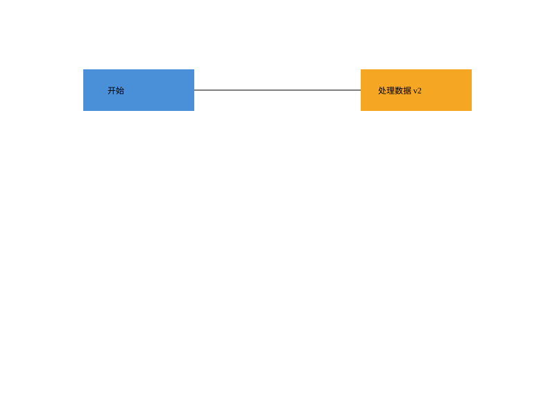
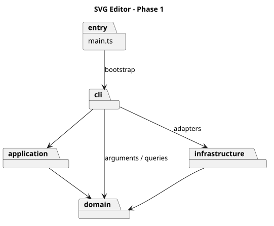
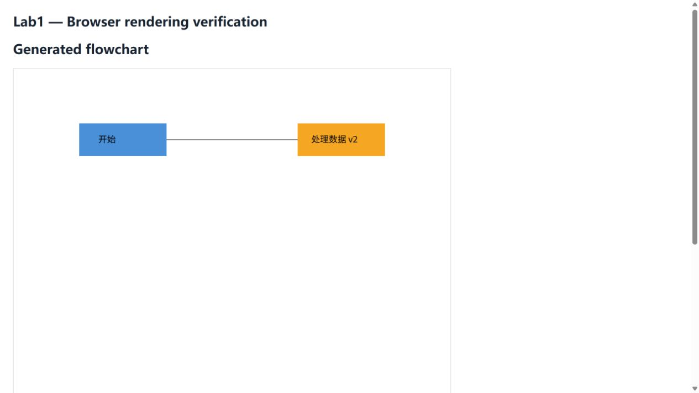

# SVG Editor — Lab1 Phase 1 作业报告

仓库地址：[Wang-Wen-Rong/pj_lab1](https://github.com/Wang-Wen-Rong/pj_lab1)

开发历史：[Git Commits](https://github.com/Wang-Wen-Rong/pj_lab1/commits/master/) · 最终交付：[final 标签](https://github.com/Wang-Wen-Rong/pj_lab1/tree/final)

本文包含运行方式、架构方案、真实协作过程、一致性自查与质量保证。根目录 README 为整合提交版，doc/README.md 保留同内容报告以符合题目指定路径。

## 运行与演示

环境：Node.js 22 或更新版本；实际验证环境为 Windows、Node.js 24.15.0。

```sh
npm ci
npm run cli
```

输入 help 查看完整命令和六类图形的参数。提示符为 svg>，支持双引号、中文、浮点坐标和以 # 开头的整行注释。颜色 #4a90d9 不会被当作注释。交互结束可用 Ctrl+D，Windows 可用 Ctrl+Z 后回车；脚本到 EOF 自动退出。

```powershell
Get-Content -Encoding utf8 examples/flowchart.txt | npm run cli
```

也可生成带命令及输出的可复现演示实录：

```sh
npm run build
node scripts/demo.mjs
```

实录见 [doc/demo-transcript.md](doc/demo-transcript.md)，包含创建、移动、撤销、修改文字、保存、读回和属性查看。保存后的 undo 错误是刻意验证历史边界的预期结果，不是演示失败。



浏览器已检查中文文字、两个节点的颜色和连线，原始截图见 [流程图渲染证据](doc/browser-flowchart.png)。本地预览可运行 node scripts/preview.mjs，再访问 http://127.0.0.1:4173；服务仅绑定本机，并且只提供两个 SVG 资源和预览页。

## 架构方案

### 模块划分与职责

- **src/domain**：Shape、Rect、Circle、Ellipse、Line、Text、Group、Document、ShapeFactory。负责几何行为、属性白名单、图形树、ID 唯一性与对象复制；不读文件，不操作终端，不维护撤销栈。
- **src/application**：Command、Editor 和具体编辑命令。负责一次编辑的事务范围、撤销重做和历史边界；不解析 XML，不决定终端树枝字符。
- **src/cli**：Tokenizer、Cli、Presenter。负责输入拆词、参数数量校验、命令分发、展示与错误前缀；调用应用层执行编辑，使用领域对象查询和验证参数。
- **src/infrastructure**：SvgCodec、FileStore。负责 XML 和文件适配；不保存编辑历史。FileStore 采用同目录临时文件加重命名，尽量避免保存失败损坏原文件。
- **src/main.ts**：组装 CLI 与 readline，管理交互提示符和 EOF；不实现图形几何。
- **tests / examples / scripts**：分别保存自动化测试、验收输入与 SVG、可重复运行的演示工具。



图由 [PlantUML 源文件](doc/architecture.puml) 渲染，箭头表示源码依赖方向。图中明确包含 CLI 对领域层的实际依赖，避免把理想分层误写成代码现状。

### 设计模式及其落地

**Command（必需）**：每条编辑命令对应一个 Command 对象，具体类如 MoveCommand、GroupCommand、DeleteCommand。Cli 构造命令，Editor 调用 execute，Command 在文档副本上调用具体 apply。成功后才替换当前文档并写入历史；异常不会把草稿交回 Editor。因此 group 即使涉及多个父容器，也仍是一个撤销单元。

**Memento（配合撤销）**：Command 保存操作前后文档快照，undo/redo 返回独立副本。对缩放直接恢复旧值，避免反向除法累计误差。每个历史单元的空间成本为 O(N)，历史长度 H 时为 O(HN)。本阶段以小型图形文档为目标，优先保证复杂树编辑恢复准确；后续可以改成局部快照，但不必改 CLI 的命令接口。

**Composite**：Group 与叶子都继承 Shape，move、scale、set、clone 采用统一接口。Group 的 move/scale 递归委托给孩子，叶子只修改自己的几何字段；不会在命令中按 tag 决定如何移动。delete 删除整棵子树，撤销恢复全部后代。普通 g 的 fill/stroke 作为容器属性，由 SVG 自身继承规则生效，不覆盖孩子显式设置的颜色。

**Factory**：ShapeFactory 集中类型名到具体类的构造映射；创建和 SVG 导入共用工厂。工厂是本阶段内置类型分发点，并非已经实现插件系统。

具体执行例：move node2 0 100 经 Tokenizer 拆词，Cli 校验参数并构造 MoveCommand；Editor 执行命令；Group.move 让矩形和文字分别移动；成功后更新历史，Presenter 可显示新状态。若其中一个后代发生数值溢出，整个草稿废弃，之前成功移动的兄弟也不会泄漏到当前文档。

### 依赖方向规则

1. domain 只能依赖 domain，不得引用 application、cli、infrastructure、node:fs 或 XML 库，确保图形逻辑可独立测试。
2. application 可以依赖 domain 和自身模块，不得引用终端或具体文件适配器。
3. infrastructure 可以依赖 domain、Node 文件 API 和 XML 库，不得反向调用 CLI 或编辑历史。
4. cli 可以依赖 application、domain、infrastructure。当前 Cli 也承担适配器组合，因此并非完全依赖倒置；后续接入 GUI 时，应把文档加载/保存用例上移并注入存储接口。
5. main 依赖 cli 和 readline；测试可以跨层验证，但生产代码不能引用 tests。

允许的名字分发集中于 Cli 的命令处理器映射和 ShapeFactory 的类型提供者映射。两处均标注为后续注册接口重构点。实例所属容器的判断用于维护树结构，不承担按图形名字分派几何行为的职责。

### 变化点假设与取舍

- **增加图形**：增加 Shape 子类并修改工厂；编辑命令无需增加类型分支。本期不提前实现插件加载、版本兼容和动态卸载。
- **增加界面**：图形与编辑命令可复用；CLI 中的文档 IO 编排需先抽出用例层，不能宣称当前可以零修改接入 GUI。
- **大文档与长历史**：Document.find 当前为 O(N) 遍历，省去索引同步负担。若规模扩大，可建立私有 ID 索引并采用局部撤销快照。
- **更多 SVG 特性**：由 SvgCodec 扩展解析范围。transform、坐标系映射和样式继承需要单独设计，避免只保留字符串却让 move/scale 的语义失真。
- **更多样式属性**：由图形类扩展 set 白名单；本期不开放任意属性修改，保持题目规定的错误行为。

### 明确的实现约定与边界

- 跨父容器 group 放在所选节点的最低公共父容器中，位于首个受影响的直属子节点之前；组内按原文档先序顺序排列。
- 成功 init/read/save/修改 canvas 清空历史并锁定 undo/redo；下一次成功编辑开启新历史。失败命令不改变当前文档、路径和撤销重做状态。canvas 查询和显示命令不建立历史边界。
- 根级 g 不允许 ungroup，严格遵循题目特例。front 移到同级末尾以在 SVG 中绘制于上层；back 移到开头。
- help 在无文档时可使用；其他非 init/read 命令要求已有文档。
- 坐标可负，几何尺寸与半径可为零但不可负，画布尺寸必须为正，所有数值必须有限。scale 同乘位置和几何尺寸，不缩放字体与 stroke-width。
- 缺失 ID 按标签名和序号补齐，先扫描所有显式 ID，再生成不冲突的名字。ID 大小写敏感。
- 本期支持 rect/circle/ellipse/line/text/g，不支持 box；create box 按要求报未知类型。
- 外部 SVG 明确拒绝 transform、非默认 viewBox、未知元素及不支持的根属性；普通图形的额外属性保留，但 set 仍受白名单限制。这是当前实现边界，不是声称老师已认可的豁免。若评分包含任意外部 SVG 或 transform，需要进一步确认并扩展。
- tree 包含内联几何属性；show 分行显示完整属性。撤销重做摘要指出被撤销/重做的操作，不承诺与示例所有成功文案逐字符相同；规定的错误文本由测试核对。

## 过程记录

以下只记录真实发生的协作与迭代。用户负责提出目标、提供仓库、审核交付方向；AI 负责实现、测试和技术自查。没有把 AI 自查虚构成用户指出的代码问题，也没有倒填提交时间。

### 关键对话与决策

1. 用户要求“理解这项作业……执行流程是怎样的”。AI 先拆分阶段边界，识别 box 为后续目标，提出分组位置和历史边界等未完全明确的语义。
2. 用户提供空仓库并要求“执行”。AI 依次完成图形模型、命令机制、CLI/持久化和测试文档。可在真实 Git 提交中查看每阶段差异。
3. SVG 读写实现时，类型检查发现 XML 库对根节点与 SVG 元素的类型推断不同；统一递归参数类型后通过检查。ID 补全采用先扫描再分配，避免与后出现的显式 ID 冲突。
4. 自查发现注册表会误认 constructor/toString 等原型名称；改为 Object.hasOwn，并增加回归测试。没有把该问题描述成用户发现。
5. 初次推送出现 GitHub 443 端口超时。用户问“你再试一下，需要我提供什么”，重试成功，并核对远程分支与标签对象。这是网络问题，未伪装成代码缺陷。
6. 用户要求“把doc的readme合并进总readme”。AI 合并报告并补仓库地址，但当时没有同步 final 标签。
7. 用户追问“目前明确完成老师所有要求了吗”。原判断是“本地实现已完成”；核查发现 final 落后于 README 提交、架构图只有源码、帮助参数不完整及导入范围存在风险。AI 修正为“主体完成，仍有交付缺口”，没有继续声称全部要求已经满足。
8. 用户要求执行质量改进，并明确“不用”添加 CI。本轮补全 help/show、增加编辑反馈上下文、增加逐项验收测试、渲染 PlantUML 图和保存浏览器截图，重新整理最终文档。真实执行结果为 19 项测试通过；未添加 GitHub Actions。

### 原判断、证据与修正

- **交付标签**：原以为已有 final 即符合要求；证据是 final 指向 a26e1f6，而文档合并已到 a70149b；修正为全部本轮改动完成后更新 final，并核对远程标签所指提交。旧提交仍可由历史追溯。
- **架构图**：原只提供 PlantUML 源码；证据是 GitHub README 中不能直接看到渲染图；修正为提交 architecture.svg 并嵌入文档，浏览器查看实际图形。
- **架构一致性**：检查 import 后发现 CLI 直接使用 domain；修正包图，明确保留这条实际依赖及未来抽离方案。
- **失败原子性**：不能只检查返回 error；新增测试比较完整树、文件路径和 redo 可用性，并用后代溢出验证部分更新不会泄漏。

### 可核查的开发提交

本轮按用户要求，将尚未上传的两次改动提交整理为四个功能主题。拆分是对已完成改动的组织，不代表重新发生了四个独立开发阶段；已上传历史保持不变，提交时间没有倒填。

- a3d9bc0：工程与多态图形模型。
- a17f00e：事务命令与撤销重做。
- d77e595：CLI 与 SVG 读写。
- a26e1f6：初始测试和交付文档。
- a70149b：合并根目录 README 并加入仓库地址。
- ef04d0b：完整帮助、属性显示与操作反馈。
- 87b612f：逐项需求验收测试。
- 96d71e3：可复现演示、PlantUML 图与真实浏览器截图。
- 后续文档/演示提交：以仓库实际 Git 历史为准；不将预想的提交写成既成事实。

## 一致性自查

实际目录与上述方案一致，各生产类使用独立同名文件。图形状态由字段封装，attributes 返回新 Map，children 返回只读数组类型；通过方法进行编辑。

application 未引用文件系统、XML 库或 cli。domain 未引用外层模块。CLI 到基础设施和领域的依赖已如实写入方案，而非误称所有 IO 编排都已隔离到应用层。

类层次使用多态的 move/scale/clone/summary/details。没有通过遍布各模块的 switch(tag) 执行图形操作；两个名字分发入口继续作为明确的后续重构项。

主要修订是将最初讨论的局部旧值撤销，落实为完整快照；以及补充图中的 CLI 到 domain 依赖。A07 自动化测试抽查依赖方向，人工审查补充未被抽查的模块；不把抽样测试说成完整静态依赖分析。

## 质量保证手段

```sh
npm run check
npm test
npm run build
npm run format:check
```

本轮实际结果：19 项测试全部通过，类型检查与构建通过。演示执行真实程序并保存输出；浏览器实际打开 SVG 检查文字、颜色和连接线。未开展跨浏览器兼容或像素级自动比对。

### 需求与验证证据

- **六种图形、浮点坐标、容器递归操作**：editor.test.ts 的 all shapes 用例检查移动和缩放后的具体数值。
- **全部编辑命令的撤销重做粒度**：acceptance.test.ts 的 A02 逐条执行，比较操作前、撤销后、重做后的完整树。
- **分组顺序、祖先冲突、防环、根级禁止解散、子树删除恢复**：editor.test.ts 的 group 与 nested ungroup 用例。
- **错误前缀及规定错误文本**：A03 逐条断言，同时验证文档不变。
- **文档创建/读取/保存/画布与历史边界**：editor.test.ts 的 IO boundaries，A04 和 A06；包含失败读写不清空 redo、不改当前路径。
- **颜色与注释、引号、中文、属性白名单、无文档行为**：editor.test.ts 的 comments 用例，A01 和 A05。
- **默认样式省略、XML 转义、读写往返、自动补 ID、重复 ID**：editor.test.ts 的 SVG round trip 与 A05。
- **数值溢出回滚、注册表特殊名称、大小写 ID**：boundaries.test.ts。
- **tree/show/help 输出**：A01 校验完整创建语法与 show 内容，其他结构测试检查 tree；CLI 子进程用例验证脚本输入和 EOF。
- **架构依赖**：A07 抽查领域层和应用层的 import，结合人工审阅。
- **真实交互演示与图像**：demo-transcript.md、flowchart.svg、browser-flowchart.png、architecture.svg、browser-architecture.png。
- **Git 与报告交付**：真实分阶段提交、远程 master、final 标签，以及根目录和 doc/ 下的完整 README。



### 尚需老师口径或外部信息确认的项目

跨父级 group 的放置规则、I/O 后旧历史是否永久丢弃、外部 transform 支持范围属于题目未完全明确或存在解读空间的部分，本文已经公开实现选择。老师若采用其他约定，应按其口径修订。尚未获得提交截止时间，因此无法替老师确认 final 标签时间满足截止要求。

本轮不新增 box、GUI、CI 或插件加载系统。重点是把本阶段已有功能的行为、证据和设计取舍交代清楚。
