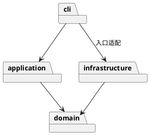

# Lab1 Phase 1：SVG CLI

## 架构方案

TypeScript、封装字段、一类一文件。domain 管理图形与树；application 管理 Command 和历史；cli 负责引号解析和分发；infrastructure 负责 XML 和文件；main 组装依赖。

领域层不依赖 IO、CLI 或应用层。应用层不依赖具体 XML 库。Command 封装编辑和撤销，Composite 通过 Shape 与 Group 多态实现，Factory 集中图形创建。名字分发仅限命令分发和图形工厂，两处列为后续注册机制重构点。

变化点：新增图形通过工厂与子类；新增界面复用领域/命令；文件格式由独立适配器处理。本期不建设插件加载器，box 明确不支持。

### 明确的实现约定

- group 将新组放在所选节点的最低公共父容器中，位于第一个受影响的直属子节点之前；子节点按原文档先序顺序收编。
- 成功 init/read/save/修改 canvas 清空历史并锁定 undo/redo；下一次成功编辑开启新历史。失败命令不改变任何状态。
- help 可在没有文档时使用。front 移到同级列表末尾（最上层），back 移到开头。
- 导入支持本期六类元素；未知元素及 transform 明确拒绝，避免静默破坏外观。普通附加 SVG 属性保留，但 CLI set 仅接受规定白名单。
- 宽高与半径允许零，不允许负值；坐标允许负数；所有数值必须有限。画布尺寸必须为正。

## 过程记录

1. 阅读作业，识别 box 属后续阶段；讨论并明确分组位置、历史边界和导入范围。
2. 检查本地目录：已有空 Git 仓库，Node 与 npm 可用；采用分阶段提交。
3. 实现领域模型后，选择 Command + Memento：每条编辑命令在文档副本上执行，成功后替换当前文档，命令保存前后快照。相较于逐节点逆操作，这对跨父容器分组更容易确保原子性；代价是每个历史单元占用 O(N) 文档空间。本阶段优先正确性，后续可换成局部快照。
4. 实现 XML 读写时，类型检查发现 XML 库对 SVGElement 与根节点的类型推断不同，将递归序列化参数统一为 Element 后通过检查。导入先扫描已有 ID，再自动编号，避免后出现的显式 ID 与自动 ID 冲突。
5. 测试首次运行被本地沙箱的 Windows 用户信息访问限制阻断；授权后测试正常运行。这是运行环境问题，未作为产品缺陷修复。
6. 自查发现普通对象注册表会把 constructor/toString 等原型属性当作已注册名称；改为 Object.hasOwn 检查，并添加回归用例。
7. 回放两节点流程图，验证嵌套创建、移动撤销、文本修改和保存。输出包含 8 个元素，与任务示例一致。

以上是实际开发记录：用户提供作业、确认执行并提供仓库；AI 完成方案细化、实现、自查与测试。没有将 AI 自查虚构成用户指出的问题。Git 历史分别记录领域模型、命令机制、CLI 与持久化、验证与交付。

## 一致性自查

实际目录与原方案一致：src/domain、src/application、src/cli、src/infrastructure、tests、examples。入口为 src/main.ts。

抽查并搜索 import：domain 仅引用 domain；application 仅引用 application 与 domain；文件系统和 XML 库仅存在于 infrastructure；readline 仅在入口使用。CLI 按方案组合文件适配器并调用应用层。没有发现逆向依赖，没有遍布各层的 switch(tag)。类型名判断集中在 ShapeFactory，命令名判断集中在 Cli；其余操作调用多态方法。

修订说明：撤销实现从最初讨论的“各命令存局部旧值”细化为统一的完整文档快照，已在本记录说明内存取舍。ID 查找目前为树遍历 O(N)，避免维护第二份索引的一致性负担；大文档时可替换为内部索引。

领域对象封装字段；children 暴露只读数组类型，attributes 返回新 Map；命令通过受控树方法编辑。普通 g 的 fill/stroke 由 SVG 继承，不强制覆盖子图形的显式颜色。缩放只作用于几何坐标与尺寸，不缩放 stroke-width 和字体大小。

## 质量保证手段

执行 npm run check、npm run build、npm test、npm run format:check。测试位于 tests/editor.test.ts 和 tests/boundaries.test.ts，覆盖：

本次实际结果：12 个测试全部通过，类型检查、构建、格式检查全部通过。运行环境为 Windows、Node.js v24.15.0。PlantUML 图源另存于 architecture.puml，可使用 PlantUML 渲染。

- 六类图形、浮点和中文文本，容器递归移动/缩放。
- create/delete/move/scale/set/group/ungroup/addto/front/back 的组合、撤销与结构恢复。
- 文档顺序分组、祖先与后代冲突、防止循环归属、根级容器禁止解散。
- 失败不改状态或 redo，undo 后新编辑清空 redo，显示命令不影响历史。
- init/read/save/canvas 的历史边界、失败读文件和无路径保存行为。
- SVG 保存再读取的一致性、XML 转义、自动补 ID、重复 ID、非法 XML 和不支持的 transform。
- CLI 子进程通过标准输入接收脚本，并在 EOF 正常退出。
- 注册表原型名称、几何溢出时多节点操作回滚、大小写敏感 ID 与删除后重用。

examples/flowchart.txt 是可重复执行的验收脚本，examples/flowchart.svg 是实际生成的结果。测试检查语义和结构；终端摘要不要求与示例逐字符一致，例如撤销反馈采用 edit undone，tree 显示完整 width/height 属性名。

已知边界：不是通用 SVG 编辑器，不支持 transform、非默认 viewBox、CSS 样式表、path/use 等其他元素；遇到不支持的结构明确拒绝。普通元素的额外属性尽量原样保留，但 set 仍限定白名单。没有实现后续阶段 box 或插件加载器，也没有图形界面。SVG 结果已通过解析和往返验证，未声称完成真实浏览器像素级比对。
