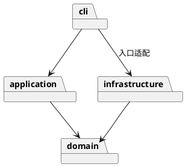

# Lab1 Phase 1：SVG CLI

## 架构方案

TypeScript、封装字段、一类一文件。domain 管理图形与树；application 管理 Command 和历史；cli 负责引号解析和分发；infrastructure 负责 XML 和文件；main 组装依赖。

领域层不依赖 IO、CLI 或应用层。应用层不依赖具体 XML 库。Command 封装编辑和撤销，Composite 通过 Shape 与 Group 多态实现，Factory 集中图形创建。名字分发仅限命令分发和图形工厂，两处列为后续注册机制重构点。

变化点：新增图形通过工厂与子类；新增界面复用领域/命令；文件格式由独立适配器处理。本期不建设插件加载器，box 明确不支持。

### 明确的实现约定

- group 将新组放在所选节点的最低公共父容器中，位于第一个受影响的直属子节点之前；子节点按原文档先序顺序收编。
- 成功 init/read/save/修改 canvas 清空历史并锁定 undo/redo；下一次成功编辑开启新历史。失败命令不改变任何状态。
- help 可在没有文档时使用。front 移到同级列表末尾（最上层），back 移到开头。
- 导入支持本期六类元素；未知元素及 transform 明确拒绝，避免静默破坏外观。普通附加 SVG 属性保留，但 CLI set 仅接受规定白名单。
- 宽高与半径允许零，不允许负值；坐标允许负数；所有数值必须有限。画布尺寸必须为正。

## 过程记录

1. 阅读作业，识别 box 属后续阶段；讨论并明确分组位置、历史边界和导入范围。
2. 检查本地目录：已有空 Git 仓库，Node 与 npm 可用；采用分阶段提交。

## 一致性自查

待实现后核查实际目录与依赖。

## 质量保证手段

计划覆盖领域几何、树约束、命令回滚、历史边界、SVG 往返和 CLI 回放，并执行类型检查与构建。
